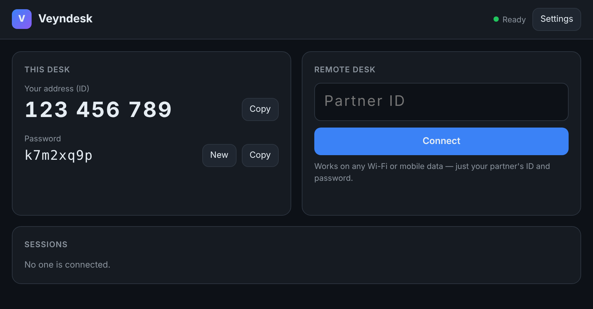

  

<h1 align="center">Veyndesk</h1>

  <b>Free, open-source remote desktop software: an AnyDesk &amp; TeamViewer alternative.</b> 
  Connect to any PC with just an ID and password. No accounts, no setup, works on any network.

  
  
  
  

  <a href="https://github.com/veyndesk/veyndesk/releases/latest"><b>⬇ Download for Windows</b></a> ·
  <a href="https://veyndesk.github.io"><b>🌐 Website</b></a> ·
  <a href="https://github.com/veyndesk/veyndesk"><b>💻 Source code</b></a> ·
  <a href="https://github.com/veyndesk/veyndesk/issues"><b>🐞 Report a bug</b></a>

  

---

### ✨ Why Veyndesk?

| | |
|---|---|
| ⚡ **Simple** | Open the app, share your ID and password, and that's it. |
| 🌍 **Works anywhere** | Direct peer-to-peer connection, with an automatic relay when a network blocks it. |
| 🔒 **Private** | End-to-end encrypted. You accept every connection. No accounts, no tracking. |
| 💸 **Free for everyone** | Free for personal *and* business use. No licence keys, no time limits. |
| 🔓 **Open source** | AGPL-3.0, built in Rust. Self-host your own server if you like. |

### 🚀 Get started in 3 steps

1. **Download** the installer from [Releases](https://github.com/veyndesk/veyndesk/releases/latest) and install it on both PCs.
2. **Share** your ID and password with your partner.
3. **Connect:** they type your ID → Connect → password, and you click **Accept**.

### 📦 Projects

| Repository | Description |
|---|---|
| [**veyndesk**](https://github.com/veyndesk/veyndesk) | The Windows remote desktop app (host + viewer), built-in server and web viewer |
| [**veyndesk.github.io**](https://github.com/veyndesk/veyndesk.github.io) | Source of the [veyndesk.github.io](https://veyndesk.github.io) website |

### 🤝 Contribute

Bug reports, ideas and pull requests are welcome. Open an [issue](https://github.com/veyndesk/veyndesk/issues) to get started.

⭐ <b>If Veyndesk helps you, please star the repo</b>: it helps others find it.

